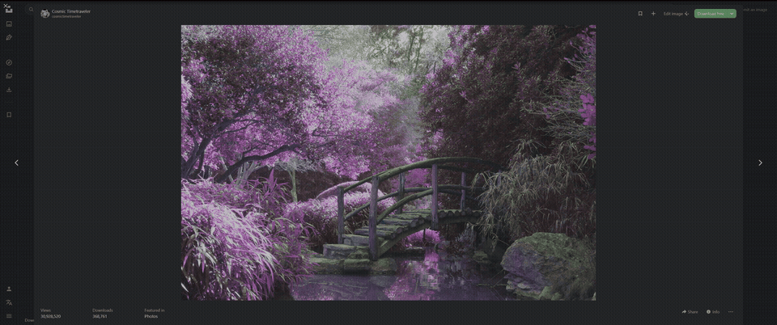

<h1 align="center">Slipframe</h1>

Immersive browsing. Effortless switching.

**Version 0.99 · Firefox · Unsigned release candidate**

Slipframe adds a built-in, Win+Tab-like overview for your open browser tabs. See your pages as visual previews, switch in one click, and optionally tuck browser controls away when you want more room for the page.

- Screenshot previews with favicons and compact tab titles.
- An automatically sized grid with subtle glass borders and a lightly blurred backdrop.
- Click to switch; middle-click or hover × to close.
- Keyboard shortcut and optional Gesturefy integration.
- Appearance controls, light/dark settings, and background preview caching.
- Optional immersive fullscreen mode with controls that reveal at the top edge.
- Local screenshot processing. No analytics, accounts, or developer-operated service.

## Feature demos

### Tab overview

Slipframe gives you a built-in, Win+Tab-like overview of all your open tabs. Scan the previews in one grid, then click a page to switch to it. Middle-click or hover over × to close a tab.

### Immersive fullscreen mode

The browser controls slide away while the page stays the same size. That avoids the jitter and page resizing some auto-hiding tab bars cause when you hover over them. Move to the top edge when you need the controls; the Windows taskbar remains accessible in this mode.

https://github.com/user-attachments/assets/e209c64b-35ff-4bca-9272-c886fa598f55

The full-resolution recordings are in [demo/](demo/).

## Try it

Download/extract this project, open about:debugging#/runtime/this-firefox in Firefox, choose **Load Temporary Add-on…**, and select extension/manifest.json. On an ordinary website, press **Ctrl+Shift+Space**. Click the Slipframe logo at bottom left of the overview to open settings.

Temporary installs disappear after restarting Firefox. Permanent installation needs Mozilla signing; this build has not been submitted or signed. The extension requires Firefox 140+. The documented optional F2 setup requires Firefox 147+.

See [START-HERE.md](START-HERE.md) for installation, updating, Gesturefy, immersive setup, limitations and rollback. See [PRIVACY.md](PRIVACY.md) for data handling and permissions.

## Set up immersive mode

In settings, download userChrome.css, open about:support → Profile Folder → Open Folder, and move the file into the profile’s chrome folder (create the folder if missing). Follow the remaining setup steps in settings to enable custom CSS, configure F2 and restart. Existing stylesheets should be backed up or merged.

The extension and native UI stylesheet are separate: installing the add-on does not automatically edit profile files. The stylesheet has been tried on maximized Windows Firefox with horizontal tabs; other configurations and browser updates need testing.

## Development

No bundled libraries, remote fonts, or build framework. Source files are in extension/.

~~~text
node tests/background.test.cjs
node tests/layout.test.cjs
node tests/settings.test.cjs
python3 build.py
~~~

Python packaging uses only the standard library. Users need neither Node nor Python to run the add-on. The resulting release/Slipframe-v0.99-unsigned.zip has manifest.json at its root for submission to Mozilla after testing.

The automated tests cover background authorization and capture behavior, preference/hotkey validation, and grid sizing. Version 0.99's visual changes still need a Firefox smoke test; passing mocks does not verify browser rendering or installation.

## License

[MIT](LICENSE.txt).
